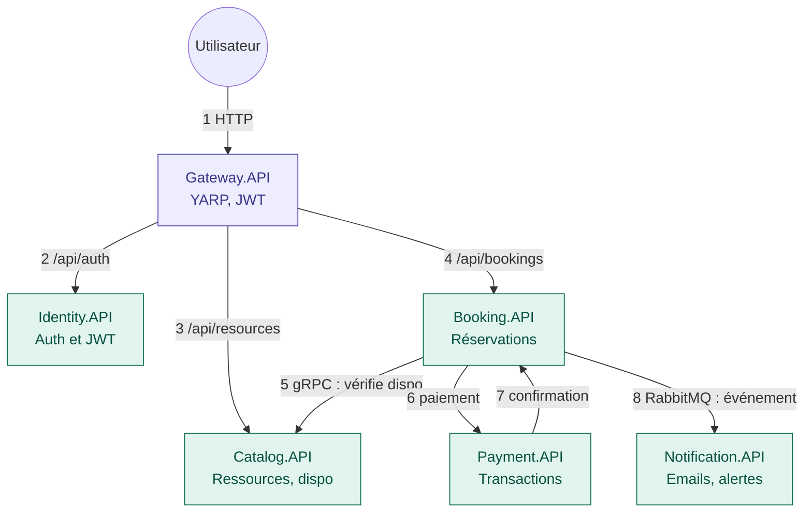

# SmartResourceHub

Plateforme de réservation de ressources basée sur une architecture **microservices** en **.NET**.

## Architecture



### Parcours d'une réservation

1. L'utilisateur envoie sa requête à **Gateway.API**, point d'entrée unique (reverse proxy YARP).
2. Il s'authentifie via **Identity.API**, qui lui délivre un token JWT. La Gateway vérifie ce token sur les routes protégées.
3. Il consulte les ressources via **Catalog.API**.
4. Il demande une réservation à **Booking.API**.
5. Booking vérifie la disponibilité de la ressource auprès de **Catalog.API** en **gRPC**.
6. Booking demande le paiement à **Payment.API**.
7. Payment confirme le paiement, la réservation est validée.
8. Booking publie un événement sur **RabbitMQ**, consommé par **Notification.API** qui envoie la confirmation.

## Microservices

| Service | Rôle | Port local | Route Gateway |
|---|---|---|---|
| `Gateway.API` | Reverse proxy YARP, validation JWT, cache Redis | — | — |
| `Identity.API` | Inscription, connexion, génération des tokens JWT | 7001 | `/api/auth/**` (publique) |
| `Catalog.API` | Gestion des ressources et disponibilités, serveur gRPC | 5133 | `/api/resources/**` (authentifiée) |
| `Booking.API` | Création et gestion des réservations | 5190 | `/api/bookings/**` (authentifiée) |
| `Payment.API` | Traitement des paiements | — | interne |
| `Notification.API` | Envoi des emails et alertes | — | interne |

## Technologies

- **.NET / ASP.NET Core** : APIs REST
- **YARP** : API Gateway (reverse proxy)
- **JWT** : authentification
- **gRPC** : communication synchrone Booking → Catalog
- **RabbitMQ** : communication asynchrone par événements
- **SQL Server** : une base par microservice (`CatalogDb`, `BookingDb`, …)
- **Redis** : cache

## Structure du projet

```
SmartResourceHub/
├── Gateway.API/
├── Identity.API/
├── Catalog.API/
├── Booking.API/
├── Payment.API/
├── Notification.API/
├── tests/
│   └── Identity.UnitTests/
└── SmartResourceHub.slnx
```

## Prérequis

- [.NET SDK](https://dotnet.microsoft.com/download)
- Visual Studio 2022 ou plus récent
- SQL Server
- RabbitMQ (en local sur `localhost`)
- Redis (en local sur `localhost:6379`)

## Installation

```bash
git clone https://github.com/Oumaima-BENABDALLAH/SmartResourceHub.git
cd SmartResourceHub
dotnet restore
dotnet build
```

## Configuration des secrets

Les mots de passe et clés **ne sont pas stockés dans le dépôt**. Ils sont gérés avec les **User Secrets** de .NET.

Pour chaque API : clic droit sur le projet dans Visual Studio → **Gérer les secrets utilisateur**, puis renseigner :

| Projet | Secrets à configurer |
|---|---|
| `Gateway.API` | `Jwt:Secret` |
| `Identity.API` | `Jwt:Secret`, chaîne de connexion |
| `Catalog.API` | `ConnectionStrings:CatalogDb` |
| `Booking.API` | `ConnectionStrings:BookingDb` |
| `Payment.API` | chaîne de connexion |
| `Notification.API` | chaîne de connexion, identifiants SMTP |

Exemple de `secrets.json` pour `Catalog.API` :

```json
{
  "ConnectionStrings": {
    "CatalogDb": "Server=VOTRE_SERVEUR;Database=CatalogDb;User Id=VOTRE_USER;Password=VOTRE_MOT_DE_PASSE;TrustServerCertificate=True"
  }
}
```

> La valeur de `Jwt:Secret` doit être **identique** dans `Gateway.API` et `Identity.API` (au moins 32 caractères).

## Lancer le projet

Dans Visual Studio : clic droit sur la solution → **Configurer les projets de démarrage** → **Plusieurs projets de démarrage**, puis mettre les 6 APIs sur **Démarrer**.

## Tests

```bash
dotnet test
```

## Auteur

**Oumaima BENABDALLAH**
